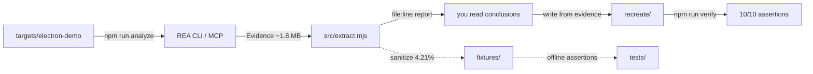

# rea-playbook

A hands-on REA playbook: inspect a minimal Electron app, turn REA's 1.8 MB Evidence JSON into readable `file:line` findings, probe the MCP server, and verify a recreate example — **without installing a native reverse-engineering engine**.

[](https://github.com/jinshi666888/rea-playbook/actions/workflows/ci.yml)
[](https://nodejs.org)
[](LICENSE)
[](tests)
[](https://github.com/jinshi666888/rea-playbook/releases)
[](https://codespaces.new/jinshi666888/rea-playbook)

[中文 README](README.zh-CN.md) · [Report issue](https://github.com/jinshi666888/rea-playbook/issues)

---

## Live demo (generated from real command output)

Three commands from zero to a line-referenced report. The first run downloads `rea-agents@6.3.0` via `npx`, so allow a couple of minutes:

```bash
npm run analyze && npm run extract && npm run verify
```


> The animation above is **generated from the real stdout** of those three commands (captured and rendered frame-by-frame), not hand-written.

---

## What this is

[REA (Reverse Engineer Anything)](https://github.com/morluto/rea) is a powerful MCP-based reverse-engineering toolkit, but getting from "I have a 1.8 MB Evidence file" to "this is what it means" is a gap.

**rea-playbook** fills that gap:

| You have | rea-playbook gives you |
|---|---|
| A desire to try REA but no analysis target | An 8-file minimal Electron app covering IPC / routing / DOM / fetch |
| A 1.8 MB Evidence file | A readable, `file:line`-referenced report (compressed to 4.21%) |
| A question about whether MCP is configured | A one-command MCP handshake + real tool call probe |
| Evidence but no code | A verified recreate loop, 10/10 assertions |

This is **not a replacement for REA**. It is the runnable layer next to it.

---

## Why not the alternatives?

1. **No native engine required** — REA's native path needs Hopper / Ghidra / IDA on macOS or Linux. REA's JavaScript / Electron path needs only Node.js. This repo proves that path end-to-end.
2. **Every claim maps to a file:line** — `profile:read @ main.js:26:0`, `route:resolve @ main.js:30:0`, not fuzzy summaries.
3. **Says "I don't know" explicitly** — REA does not pair IPC channels by textual similarity. We test that `paired_renderer_transmissions: 0` stays zero.
4. **1.8 MB → 75 KB** — the fixture extractor keeps only verifiable facts. The offline sample is 4.21% of the original.
5. **Recreate is tested** — evidence → code → test, all in one repo.

| Approach | Install | Traceable | Handles uncertainty | Regression tests |
|---|---|---|---|---|
| Throw code at an LLM | None | No | No | No |
| Ghidra / Hopper manual | Engine + license | Yes | Yes | No |
| Plain AST tooling (ast-grep, etc.) | Light | Syntax only | N/A | Sometimes |
| **REA + rea-playbook** | **Only Node.js** | **Yes, to the line** | **Yes, via limitations** | **Yes, 32 tests** |

---

## Requirements

- **Node.js 22.19+, 24.11+, or 26+.** Node 23 and 25 are not supported by REA's JavaScript path.
- **npm** (ships with Node) — installs this repo's dependencies. This is the only step that needs network access.
- **No native reverse-engineering engine required** for the JavaScript / Electron path. REA's native path (Hopper / Ghidra / IDA) is optional and is not used here.
- **Internet access** is required once, to run `npm install` (it fetches the project's dependencies). After that, `npm run demo:offline` runs with **no network and no REA** — it only reads the bundled fixture.

---

## Three ways to try

### 1. Offline preview — no REA, no network

The fastest way to see what the output looks like. It only reads the bundled, sanitized fixture and runs pure-Node assertions.

```bash
npm install          # or skip this in GitHub Codespaces
npm run demo:offline # → reads fixtures/electron-demo.evidence.json, prints report, runs 10/10 checks
```

This path does **not** call `npx`, download `rea-agents`, or start any reverse-engineering engine.

### 2. Real analysis — calls REA

```bash
git clone https://github.com/jinshi666888/rea-playbook.git
cd rea-playbook
npm install
npm run analyze   # Decompile: produce local Evidence with REA
npm run extract   # Understand: line-referenced report
npm run verify    # Recreate: 10/10 assertions
```

`npm run analyze` will fetch `rea-agents@6.3.0` on first use via `npx` fallback.

### 3. GitHub Codespaces

Click the **Open in GitHub Codespaces** badge at the top. The container has Node.js 22 and `npm install` pre-run.

---

## Verify the MCP channel

```bash
npm run probe
# REA launcher: node_modules
# serverInfo:   {"name":"rea","version":"6.3.0"}
# tools:        139 total, 58 available
# analyze_javascript_application: isError=false
```

MCP config for your client (REA uses stdio, the positional arg is `mcp`):

```json
{
  "mcpServers": {
    "rea": {
      "command": "npx",
      "args": ["-y", "rea-agents@6.3.0", "mcp"]
    }
  }
}
```

Pin the version. After writing the config, restart your client.

---

## Architecture

```text
rea-playbook/
├── bin/rea-playbook.mjs        # CLI: demo:offline / analyze / extract / verify / probe / doctor
├── src/
│   ├── extract.mjs             # Evidence → structured facts with file:line
│   ├── mcp-probe.mjs           # MCP stdio probe
│   └── paths.mjs               # no hard-coded machine paths
├── targets/electron-demo/      # 8-file minimal target
├── recreate/                   # evidence → code → test loop
├── fixtures/                   # sanitized offline sample (75 KB)
├── scripts/
│   ├── lint.mjs                # zero-dependency static checks
│   └── make-fixture.mjs        # generate sanitized fixture from real Evidence
└── tests/                      # 32 tests, fully offline
```



---

## Use cases

- **Want to learn REA but don't know where to start** → `npm run demo:offline` shows real output in one minute.
- **Need to analyze your own Electron app** → `npm run analyze -- /your/app/dir /tmp/out.json`, then `npm run extract /tmp/out.json`.
- **Want to plug REA into your own agent** → copy `src/mcp-probe.mjs` and run `npm run probe` to verify.
- **Need to prove a reverse-engineering conclusion** → `npm run extract` output carries exact file:line references for docs or review.

---

## Example: a complete analysis output

```bash
$ npm run extract

Evidence: 7 files, 5 parsed JS, 767 AST nodes, 27 findings

### IPC CHANNELS (6)
  profile:read       side=main  op=handle  channel=profile:read      resolution=literal  @ main.js:26:0
  route:resolve      side=main  op=handle  channel=route:resolve     resolution=literal  @ main.js:30:0
  profile:telemetry side=main  op=on      channel=profile:telemetry resolution=literal  @ main.js:34:0

### ELECTRON BOUNDARIES
  [browser-window] BrowserWindow@13:14-20:4                        @ main.js:13:14
  [context-bridge-api] demoBridge members=[readProfile,resolveRoute,sendTelemetry] @ preload.js:7:0

### NETWORK
  [request]  fetch @ src/profile-store.js:4
  [response] json  @ src/profile-store.js:13

### LIMITATIONS
  - Dynamic IPC channel expressions remain unresolved and are never paired by textual similarity.
```

Full deployment and troubleshooting guides are in [`docs/`](docs).

---

## FAQ

Frequent questions live in [`docs/FAQ.md`](docs/FAQ.md). Highlights:

| Symptom | Answer |
|---|---|
| `rea doctor` reports `healthy: false` | Only `node` and `host` matter for the JS path; missing engines are expected |
| `58/139 tools available` | Expected — the rest need native engines or Linux/macOS features |
| MCP `Input validation error` | The parameter is **`input_path`**, not `path` |
| Node 23 / 25 fails | Not supported; use 22.19+ / 24.11+ / 26+ |
| `git clone` fails with `invalid index-pack output` | This machine's GitHub transport is flaky; use npm path or a different network |

---

## Contributing

PRs and issues are welcome. The four best types of contribution:

1. Add a new analysis target under `targets/`.
2. Add a new extraction dimension in `src/extract.mjs` with a test.
3. Add a real error and fix to `docs/TROUBLESHOOTING.md` or `docs/FAQ.md`.
4. Translate or improve documentation.

Run `npm run check` (lint + typecheck + tests) before opening a PR.

See [`CONTRIBUTING.md`](CONTRIBUTING.md).

---

## Roadmap

- [x] v1.0 — Electron target + Evidence extraction + Recreate loop + MCP probe
- [ ] Website-frontend target: CDP example with DOM / network extraction
- [ ] A real `.asar` sample that can be publicly redistributed
- [ ] `compare_application_versions` workflow example
- [ ] English localization of remaining docs (already in progress)

---

## Related links

- REA upstream: <https://github.com/morluto/rea>
- REA npm package: <https://www.npmjs.com/package/rea-agents> (package name is `rea-agents`, not `rea`)
- REA website: <https://rea.tools/>
- Changelog: [`CHANGELOG.md`](CHANGELOG.md)
- Growth log: [`docs/growth-log.md`](docs/growth-log.md)

---

## License

[MIT](LICENSE) © 2026 jinshi666888

This repo does not contain REA source code. It calls the published `rea-agents` npm package at runtime. REA itself is MIT and its copyright belongs to its authors.
