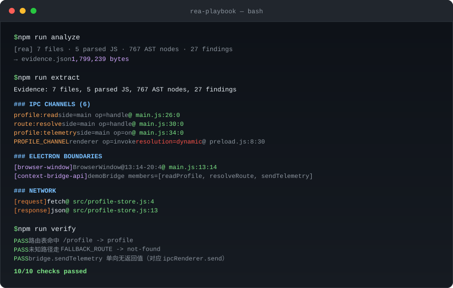
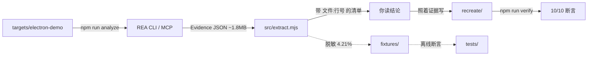

<div align="center">

# rea-playbook

**把 REA（Reverse Engineer Anything）从"知道有这个东西"变成"照着做就能跑通"。**

一个最小可分析的 Electron 靶场、一个 Evidence 提取器、一个 MCP 探针，和一条已经跑通的
`Decompile → Understand → Recreate` 闭环。

[](https://github.com/jinshi666888/rea-playbook/actions/workflows/ci.yml)
[](https://nodejs.org)
[](LICENSE)
[](tests)
[](https://github.com/jinshi666888/rea-playbook/releases)

</div>

## 30 秒看效果

三条命令，从零到一份带行号的结论清单：

```bash
npm run analyze && npm run extract && npm run verify
```



<details>
<summary>纯文本版（SVG 不显示时看这里）</summary>

```
$ npm run analyze
  [rea] 7 files · 5 parsed JS · 767 AST nodes · 27 findings
  → evidence.json (1,799,239 bytes)

$ npm run extract
### IPC CHANNELS (6)
  profile:read      side=main  op=handle  @ main.js:26:0
  route:resolve     side=main  op=handle  @ main.js:30:0
  profile:telemetry side=main  op=on      @ main.js:34:0
### NETWORK
  [request]  fetch @ src/profile-store.js:4
  [response] json  @ src/profile-store.js:13

$ npm run verify
  PASS  路由表命中 /profile -> profile
  ...
  10/10 checks passed
```

</details>

> **English TL;DR** — This repo is a hands-on playbook for
> [REA](https://github.com/morluto/rea). It ships a minimal Electron target, an
> extractor that turns a 1.8 MB Evidence file into a readable, line-referenced
> report, an MCP probe, and a verified recreate loop. Everything here is
> executable and tested — no extra reverse-engineering engine required.

---

## 目录

- [这是什么](#这是什么)
- [为什么不用别的方式](#为什么不用别的方式)（5 个亮点 + 同类对比）
- [快速开始](#快速开始)
- [架构](#架构)
- [使用场景](#使用场景)
- [示例输出](#示例一次完整分析的输出)
- [Roadmap](#roadmap)
- [贡献](#贡献)

---

## 这是什么

REA 是一个基于 MCP 的逆向工程工具，能力很强，但上手有几道坎：

- 它输出一份 **1.8 MB 的 Evidence JSON**，人没法直接读
- 它的 MCP 有 **139 个工具**，其中 81 个需要你没装的分析引擎，新手分不清哪些能用
- 官方文档讲清了"怎么装"，但"拿到证据之后怎么变成代码"这一步是空的

**rea-playbook 补的就是这段路。** 它不是一个替代品，而是 REA 旁边的实操层：

| 你有什么 | rea-playbook 给你 |
|---|---|
| 想试 REA 但没有分析目标 | 一个 8 文件的最小 Electron 应用，覆盖 IPC / 路由 / DOM / fetch |
| 一份 1.8 MB 的 Evidence | 一份带 `文件:行号` 的可读清单（压缩到 4.21%） |
| 不确定 MCP 是否配好 | 一条命令验证握手、工具清单与真实调用 |
| 不知道证据怎么变成代码 | 一个跑通的 Recreate 示例，10/10 断言 |

---

## 为什么不用别的方式

### 5 个差异化亮点

#### 1. 零引擎起步 —— 不需要 Hopper / Ghidra / IDA

REA 的原生分析需要 Hopper、Ghidra 或 IDA，且宿主基线是 macOS 12+ / Ubuntu 24.04+。
**但它的 JavaScript / Electron 路线什么都不需要**，只要 Node.js。

可验证：

```bash
npm run doctor
# node  → ok, 22.22.2
# host  → ok, win32 x64
# hopper/ghidra/ida → missing_analysis_engine
```

`healthy: false` 是因为引擎没装 —— **JavaScript 路线照样全通**。本仓库 28 个测试
在 Node 22.19 与 24.11 上全绿，过程中没有启动过任何逆向引擎。

> 顺带说清楚：REA 报 `58/139 tools available` 是**正常状态**，不是故障。
> 多出的 81 个要原生引擎或 Linux/macOS 专属能力，走 JS 路线用不到。

#### 2. 每条结论都能回到 `文件:行号`

不是"AI 觉得这里大概有个 IPC"，而是明确指出它在哪一行。

实测输出（节选）：

```
### IPC CHANNELS (6)
  profile:read       side=main     op=handle  resolution=literal  @ main.js:26:0
  route:resolve      side=main     op=handle  resolution=literal  @ main.js:30:0
  profile:telemetry  side=main     op=on      resolution=literal  @ main.js:34:0
  PROFILE_CHANNEL    side=renderer op=invoke  resolution=dynamic  @ preload.js:8:30
  ROUTE_CHANNEL      side=renderer op=invoke  resolution=dynamic  @ preload.js:9:29
  TELEMETRY_CHANNEL  side=renderer op=send    resolution=dynamic  @ preload.js:10:30

### ELECTRON BOUNDARIES
  [browser-window] BrowserWindow@13:14-20:4                        @ main.js:13:14
  [context-bridge-api] demoBridge members=[readProfile,resolveRoute,sendTelemetry] @ preload.js:7:0
```

6 条 IPC 通道、3 个 handler、1 个 BrowserWindow、1 个 contextBridge —— 每一条都能
打开文件跳过去核对。本仓库的测试直接断言这些行号。

#### 3. 不知道就说不知道 —— 不做"看起来很合理"的配对

`preload.js` 里的三个通道是**常量引用**，REA 没有硬猜它们等于什么：

```
paired_renderer_transmissions: 0
```

它在 `limitations` 里写得很直白：

> Dynamic IPC channel expressions remain unresolved and are never paired by
> textual similarity.

这不是缺陷，是设计。宁可给 `resolution: dynamic`，也不编一个"大概是 profile:read"。
**本仓库的测试专门断言了这一点**：3 个动态通道的 `channel` 字段必须是 `null`。

#### 4. 1.8 MB → 75 KB：Evidence 降噪 95.79%

原始 Evidence 是给人看的反面教材。提取器只保留可回溯的事实：

```
输入: evidence.json (1,799,239 字节)
输出: fixtures/electron-demo.evidence.json (75,821 字节)
压缩比: 4.21%
```

自己复现压缩比：

```bash
npm run analyze                          # 先产出一个真实 Evidence
node scripts/make-fixture.mjs evidence.json /tmp/slim.json
```

#### 5. 闭环可验证：证据 → 代码 → 测试

REA 到"给证据"就结束了。本仓库补了后半段，并且**让它可回归**：

```bash
npm run verify
#   PASS  路由表命中 /profile -> profile
#   PASS  未知路径走 FALLBACK_ROUTE -> not-found
#   PASS  bridge.readProfile 降级到 local-cache（对应 catch 分支）
#   PASS  bridge.sendTelemetry 单向无返回值（对应 ipcRenderer.send）
#   ...
# 10/10 checks passed
```

`recreate/` 下每个文件头部都标了它对应哪条证据（哪个文件、第几行）。改坏了会立刻红。

### 和同类做法的对比

| 方式 | 装东西 | 结论可回溯 | 会用"不知道"兜底 | 有回归测试 |
|---|---|---|---|---|
| 把代码直接丢给 LLM | 不需要 | 否，容易编 | 否 | 否 |
| Ghidra / Hopper 手工逆向 | 要装，且要许可 | 是 | 是 | 否 |
| 纯 AST 工具（ast-grep 等） | 轻量 | 语法级，无 IPC/Electron 语义 | 不适用 | 视项目 |
| **REA + 本 playbook** | **只需 Node.js** | **是，精确到行** | **是，显式 limitations** | **是，28 个测试** |

需要说明的是：**本仓库不是 REA 的替代品，也不改 REA 一行代码**。REA 负责分析，
本仓库负责让你把分析结果用起来。

---

## 快速开始

### 环境要求

- Node.js `22.19+` / `24.11+` / `26+`（**23 和 25 不受 REA 支持**）
- npm

```bash
node -v    # 确认版本
```

### 三步跑通

```bash
git clone https://github.com/jinshi666888/rea-playbook.git
cd rea-playbook
npm install

npm run analyze     # ① Decompile：分析内置 Electron 目标，产出 Evidence
npm run extract     # ② Understand：把 Evidence 变成带行号的可读清单
npm run verify      # ③ Recreate：跑复现代码的断言测试
```

`npm run analyze` 会自动定位 REA：优先用 `REA_BIN` 环境变量，其次本地
`node_modules/.bin/rea`，最后回退到 `npx rea-agents@6.3.0`。

### 验证 MCP 通道

```bash
npm run probe
# REA launcher: node_modules
# serverInfo:   {"name":"rea","version":"6.3.0"}
# tools:        139 total, 58 available
#   analyze_javascript_application PRESENT
# analyze_javascript_application: isError=false
```

### 接上你自己的 AI 客户端

REA 的 MCP 服务是 **stdio** 传输，入口参数是 `mcp`：

```json
{
  "mcpServers": {
    "rea": {
      "command": "npx",
      "args": ["-y", "rea-agents@6.3.0", "mcp"]
    }
  }
}
```

版本号**写死**而不是 `@latest`，配置后**重启客户端**。
REA 的 `setup` 命令支持 Claude Code、Codex、Cursor、Gemini CLI、Windsurf、
OpenCode、VS Code 等客户端，交互式运行即可：

```bash
npx rea-agents setup
```

---

## 架构

### 目录

```
rea-playbook/
├── bin/rea-playbook.mjs    统一 CLI 入口（analyze / extract / verify / probe / doctor）
├── src/
│   ├── paths.mjs           路径与 REA 可执行文件的唯一解析处（无硬编码机器路径）
│   ├── extract.mjs         Evidence → 带行号的结构化事实
│   └── mcp-probe.mjs       通过 MCP 协议验证 REA
├── targets/electron-demo/  最小可分析目标（8 文件）
├── recreate/               证据 → 代码 → 测试的闭环示例
├── fixtures/               脱敏的精简 Evidence（75 KB，供离线测试）
├── scripts/
│   ├── lint.mjs            零依赖静态检查
│   └── make-fixture.mjs    从真实 Evidence 生成脱敏样本
└── tests/                  28 个测试
```

### 数据流



### 设计约束

1. **没有硬编码的机器路径**。所有路径走 `src/paths.mjs`，`npm run lint` 和
   `tests/hygiene.test.mjs` 双重拦截。
2. **测试不能依赖网络或 REA**。核心测试跑在 `fixtures/` 的脱敏样本上，
   `npm test` 离线即可通过。
3. **Evidence 产物不入库**。`.gitignore` 排除 `evidence.json`，它含本机绝对路径。

---

## 使用场景

**想学 REA 但不知道从哪下手**
→ 直接 `npm run analyze && npm run extract`，两分钟看到真实输出长什么样。

**要分析自己的 Electron 应用**
```bash
npm run analyze -- /your/app/dir /tmp/out.json
node bin/rea-playbook.mjs extract /tmp/out.json
```
`.asar` 文件同样支持，REA 会自动识别。

**要把 REA 接进自己的 Agent**
→ 抄 `src/mcp-probe.mjs` 的连接方式，用 `npm run probe` 验证。

**要向团队证明"这个逆向结论可信"**
→ 用 `npm run extract` 的输出，每条都带行号，可直接贴进文档或评审。

---

## 示例：一次完整分析的输出

```bash
$ npm run extract

Evidence: 7 files, 5 parsed JS, 767 AST nodes, 27 findings

### IPC CHANNELS (6)
  profile:read           side=main  op=handle  channel=profile:read      resolution=literal  @ main.js:26:0
  route:resolve          side=main  op=handle  channel=route:resolve     resolution=literal  @ main.js:30:0
  profile:telemetry      side=main  op=on      channel=profile:telemetry resolution=literal  @ main.js:34:0
  PROFILE_CHANNEL        side=renderer op=invoke channel=<dynamic>       resolution=dynamic  @ preload.js:8:30
  ROUTE_CHANNEL          side=renderer op=invoke channel=<dynamic>       resolution=dynamic  @ preload.js:9:29
  TELEMETRY_CHANNEL      side=renderer op=send   channel=<dynamic>       resolution=dynamic  @ preload.js:10:30

### IMPORTS (14)
  main.js -> electron
  main.js -> node:path
  main.js -> src/routes.js
  ...

### NETWORK
  [request]  fetch @ src/profile-store.js:4
  [response] json  @ src/profile-store.js:13

### LIMITATIONS
  - Dynamic IPC channel expressions remain unresolved and are never paired by textual similarity.
  - Electron relationships are derived from inert syntax; runtime registration, reachability,
    defaults, and enforcement remain unproven.
  - Graph coverage is incomplete; unavailable facts remain explicit and must not be read as absence.
```

完整的部署细节与排错手册见 [`docs/`](docs)。

---

## Roadmap

- [x] v1.0 — Electron 靶场 + Evidence 提取 + Recreate 闭环 + MCP 探针
- [ ] 网站前端靶场：`inspect_web_page` 的 CDP 示例与 DOM / 网络证据提取
- [ ] `.asar` 真实应用示例（需要一个可公开分发的样本）
- [ ] `compare_application_versions` 的版本差异工作流示例
- [ ] 多目标对比报告模板
- [ ] 英文版 README

欢迎提 issue 或 PR，见 [CONTRIBUTING.md](CONTRIBUTING.md)。

---

## 贡献

PR 与 issue 都欢迎，流程见 [CONTRIBUTING.md](CONTRIBUTING.md)。最容易被接受的四类改动：

1. 新增分析靶场（`targets/` 下加一个最小可复现目标）
2. 新的证据提取维度（`src/extract.mjs` 里加一类节点，配一条测试）
3. 排错手册里补一条你真实遇到并解决的报错（`docs/TROUBLESHOOTING.md`）
4. 英文版 README（Roadmap 里挂着）

提交前请跑一次 `npm run check`（lint + typecheck + 28 个测试）。

---

## 相关链接

- REA 上游：<https://github.com/morluto/rea>
- REA npm 包：<https://www.npmjs.com/package/rea-agents>（包名是 `rea-agents`，不是 `rea`）
- REA 官网：<https://rea.tools/>
- 变更记录：[CHANGELOG.md](CHANGELOG.md)

---

## License

[MIT](LICENSE) © 2026 jinshi666888

本仓库不含 REA 的任何源码，仅在运行时调用已发布的 `rea-agents` npm 包。
REA 自身为 MIT 许可，版权归其作者所有。
