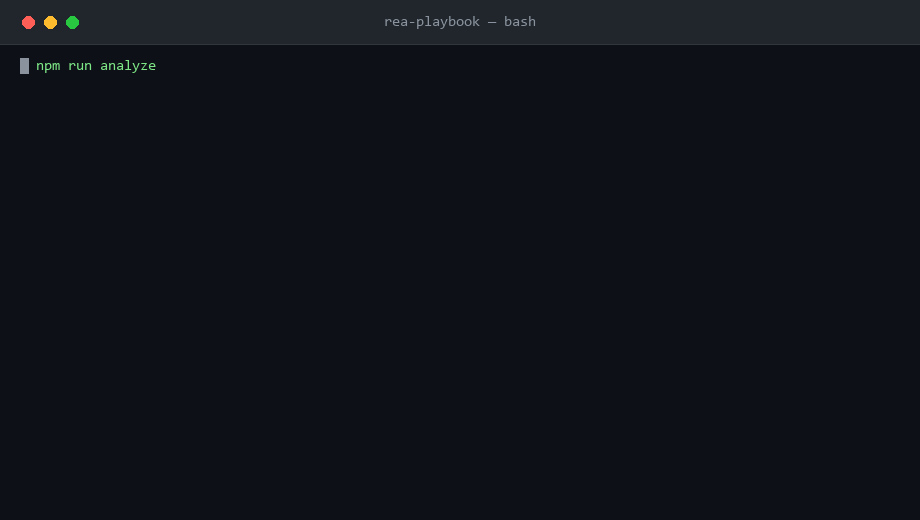
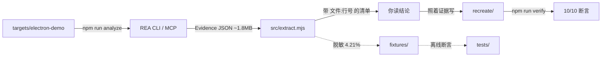

<div align="center">

# rea-playbook

**把 REA（Reverse Engineer Anything）从"知道有这个东西"变成"照着做就能跑通"。**

一个最小可分析的 Electron 靶场、一个 Evidence 提取器、一个 MCP 探针，和一条已经跑通的
`Decompile → Understand → Recreate` 闭环。

[](https://github.com/jinshi666888/rea-playbook/actions/workflows/ci.yml)
[](https://nodejs.org)
[](LICENSE)
[](tests)
[](https://github.com/jinshi666888/rea-playbook/releases)
[](https://codespaces.new/jinshi666888/rea-playbook)

[English README](README.md) · [报告问题](https://github.com/jinshi666888/rea-playbook/issues)

</div>

---

## 终端演示（基于真实命令输出生成）

三条命令，从零到一份带行号的结论清单。第一次运行会通过 `npx` 拉取 `rea-agents@6.3.0`，请留出几分钟：

```bash
npm run analyze && npm run extract && npm run verify
```



> 上图来自命令的**真实**输出，不是手写的。生成器读取了三条命令的实际 stdout 后逐帧渲染。

---

## 这是什么

[REA (Reverse Engineer Anything)](https://github.com/morluto/rea) 是个很强的 MCP 逆向工程工具，但
从"拿到一份 1.8 MB 的 Evidence JSON"到"我看懂这意味着什么"之间，有道沟。

**rea-playbook** 补的就是这段路：

| 你有什么 | rea-playbook 给你 |
|---|---|
| 想试 REA 但没有分析目标 | 一个 8 文件的最小 Electron 应用，覆盖 IPC / 路由 / DOM / fetch |
| 一份 1.8 MB 的 Evidence | 一份带 `文件:行号` 的可读清单（压缩到 4.21%） |
| 不确定 MCP 是否配好 | 一条命令验证握手、工具清单与真实调用 |
| 证据怎么变成代码 | 一个跑通的 Recreate 示例，10/10 断言 |

这不是 REA 的替代品，是它旁边的实操层。

---

## 为什么不用别的方式

1. **零引擎起步** — REA 原生分析要 Hopper / Ghidra / IDA，且宿主基线是 macOS 12+ / Ubuntu 24.04+。但 **JavaScript / Electron 路线只要 Node.js**。
2. **每条结论都回到 `文件:行号`** — `profile:read @ main.js:26:0`、`route:resolve @ main.js:30:0`，不是模糊总结。
3. **不知道就说不知道** — REA 不硬猜 IPC 通道配对。我们专门测试 `paired_renderer_transmissions: 0` 必须保持为 0。
4. **1.8 MB → 75 KB** — 提取器只保留可回溯的事实，离线样本只有原体积的 4.21%。
5. **闭环可验证** — 证据 → 代码 → 测试，全在一个仓库里。

| 方式 | 装东西 | 结论可回溯 | 会用"不知道"兜底 | 有回归测试 |
|---|---|---|---|---|
| 把代码直接丢给 LLM | 不需要 | 否 | 否 | 否 |
| Ghidra / Hopper 手工逆向 | 要装，且要许可 | 是 | 是 | 否 |
| 纯 AST 工具（ast-grep 等） | 轻量 | 语法级 | 不适用 | 视项目 |
| **REA + rea-playbook** | **只需 Node.js** | **是，精确到行** | **是，显式 limitations** | **是，32 个测试** |

---

## 环境要求

- **Node.js 22.19+、24.11+ 或 26+。**REA 的 JavaScript 路线不支持 Node 23 / 25。
- **npm**（随 Node 自带）——安装本仓库的依赖；这是唯一需要联网的步骤。
- **无需原生逆向引擎。**JavaScript / Electron 路线只要 Node.js；REA 的原生路线（Hopper / Ghidra / IDA）是可选的，本仓库用不到。
- **联网只在安装阶段需要一次。**`npm install` 会拉取依赖；装完之后，`npm run demo:offline` 执行期间**不联网、不调用 REA**，只读取仓库内自带的脱敏样本。

---

## 三种上手方式

### 1. 离线预览 —— 不装 REA、不联网

最快看输出长什么样，只读仓库自带的脱敏样本，跑纯 Node 断言。

```bash
npm install            # 在 Codespaces 里这步已经自动完成
npm run demo:offline   # → 读取 fixtures/electron-demo.evidence.json，打印报告，跑 10/10 检查
```

这条路径**不会**调用 `npx`、下载 `rea-agents`、启动任何逆向引擎。

### 2. 真实分析 —— 调用 REA

```bash
git clone https://github.com/jinshi666888/rea-playbook.git
cd rea-playbook
npm install

npm run analyze   # Decompile：调用 REA 分析目标，产出本地 Evidence
npm run extract   # Understand：把 Evidence 变成带行号的可读清单
npm run verify    # Recreate：跑复现代码的断言测试
```

第一次执行 `npm run analyze` 时，如果本地没有 REA，会通过 `npx` 自动拉取 `rea-agents@6.3.0`。

### 3. GitHub Codespaces

点击顶部的 **Open in GitHub Codespaces** 徽章。容器已配好 Node.js 22，`npm install` 已自动跑完。

---

## 验证 MCP 通道

```bash
npm run probe
# REA launcher: node_modules
# serverInfo:   {"name":"rea","version":"6.3.0"}
# tools:        139 total, 58 available
# analyze_javascript_application: isError=false
```

REA 的 MCP 服务是 **stdio** 传输，入口参数是 `mcp`：

```json
{
  "mcpServers": {
    "rea": {
      "command": "npx",
      "args": ["-y", "rea-agents@6.3.0", "mcp"]
    }
  }
}
```

版本号**写死**而不是 `@latest`，配置后**重启客户端**。REA 的 `setup` 命令支持 Claude Code、Codex、Cursor、Gemini CLI、Windsurf、OpenCode、VS Code 等：

```bash
npx rea-agents setup
```

---

## 架构

```text
rea-playbook/
├── bin/rea-playbook.mjs    统一 CLI：demo:offline / analyze / extract / verify / probe / doctor
├── src/
│   ├── extract.mjs         Evidence → 带行号的结构化事实
│   ├── mcp-probe.mjs       通过 MCP 协议验证 REA
│   └── paths.mjs           路径与 REA 可执行文件的唯一解析处（无硬编码机器路径）
├── targets/electron-demo/  最小可分析目标（8 文件）
├── recreate/               证据 → 代码 → 测试的闭环示例
├── fixtures/               脱敏的精简 Evidence（75 KB，供离线测试）
├── scripts/
│   ├── lint.mjs            零依赖静态检查
│   └── make-fixture.mjs    从真实 Evidence 生成脱敏样本
└── tests/                  32 个测试
```



---

## 使用场景

**想学 REA 但不知道从哪下手**
→ `npm run demo:offline` 一分钟看到真实输出。

**要分析自己的 Electron 应用**
```bash
npm run analyze -- /your/app/dir /tmp/out.json
npm run extract /tmp/out.json
```

**要把 REA 接进自己的 Agent**
→ 抄 `src/mcp-probe.mjs` 的连接方式，用 `npm run probe` 验证。

**要向团队证明"这个逆向结论可信"**
→ 用 `npm run extract` 的输出，每条都带行号，可直接贴进文档或评审。

---

## 示例：一次完整分析的输出

```bash
$ npm run extract

Evidence: 7 files, 5 parsed JS, 767 AST nodes, 27 findings

### IPC CHANNELS (6)
  profile:read       side=main  op=handle  channel=profile:read      resolution=literal  @ main.js:26:0
  route:resolve      side=main  op=handle  channel=route:resolve     resolution=literal  @ main.js:30:0
  profile:telemetry side=main  op=on      channel=profile:telemetry resolution=literal  @ main.js:34:0

### ELECTRON BOUNDARIES
  [browser-window] BrowserWindow@13:14-20:4                        @ main.js:13:14
  [context-bridge-api] demoBridge members=[readProfile,resolveRoute,sendTelemetry] @ preload.js:7:0

### NETWORK
  [request]  fetch @ src/profile-store.js:4
  [response] json  @ src/profile-store.js:13

### LIMITATIONS
  - Dynamic IPC channel expressions remain unresolved and are never paired by textual similarity.
```

完整的部署细节与排错手册见 [`docs/`](docs)。

---

## 常见问题

高频问题在 [`docs/FAQ.md`](docs/FAQ.md)。几个最常被问的：

| 现象 | 结论 |
|---|---|
| `rea doctor` 报 `healthy: false` | 只看 `node` 和 `host` 两项，都是 ok 就能跑；缺失的是原生引擎 |
| `58/139 tools available` | **正常**，其余 81 个需 Hopper/Ghidra/IDA 或 Linux/macOS |
| MCP 工具调用报 `Input validation error` | 参数名是 **`input_path`**，不是 `path` |
| Node 23 / 25 不能用 | 明确不支持，只能用 22.19+ / 24.11+ / 26+ |
| `git clone` 报 `invalid index-pack output` | 本机网络链路问题，走 npm 通道或换网络 |

---

## 贡献

PR 与 issue 都欢迎，流程见 [CONTRIBUTING.md](CONTRIBUTING.md)。最容易被接受的四类改动：

1. 新增分析靶场（`targets/`）
2. 新的证据提取维度（`src/extract.mjs`，配一条测试）
3. FAQ / 排错手册里补一条你真实遇到并解决的报错
4. 翻译或改进文档

提交前请跑一次 `npm run check`。

---

## Roadmap

- [x] v1.0 — Electron 靶场 + Evidence 提取 + Recreate 闭环 + MCP 探针
- [ ] 网站前端靶场：`inspect_web_page` 的 CDP 示例与 DOM / 网络证据提取
- [ ] `.asar` 真实应用示例（需要一个可公开分发的样本）
- [ ] `compare_application_versions` 的版本差异工作流示例
- [ ] 英文版 README（已完成，本仓库默认入口为英文）

---

## 相关链接

- REA 上游：<https://github.com/morluto/rea>
- REA npm 包：<https://www.npmjs.com/package/rea-agents>（包名是 `rea-agents`，不是 `rea`）
- REA 官网：<https://rea.tools/>
- 变更记录：[CHANGELOG.md](CHANGELOG.md)
- 增长日志：[docs/growth-log.md](docs/growth-log.md)

---

## License

[MIT](LICENSE) © 2026 jinshi666888

本仓库不含 REA 的任何源码，仅在运行时调用已发布的 `rea-agents` npm 包。REA 自身为 MIT 许可，版权归其作者所有。
